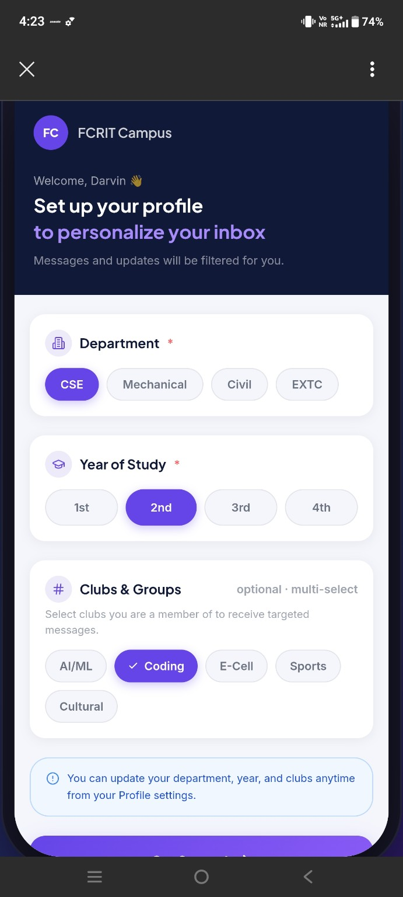
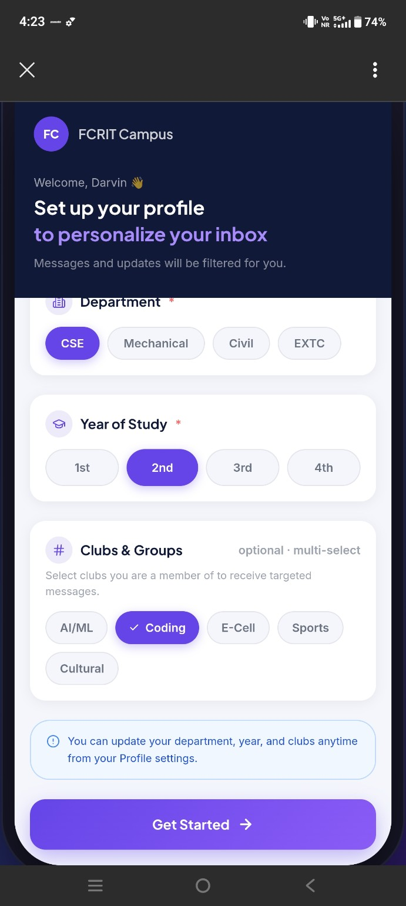
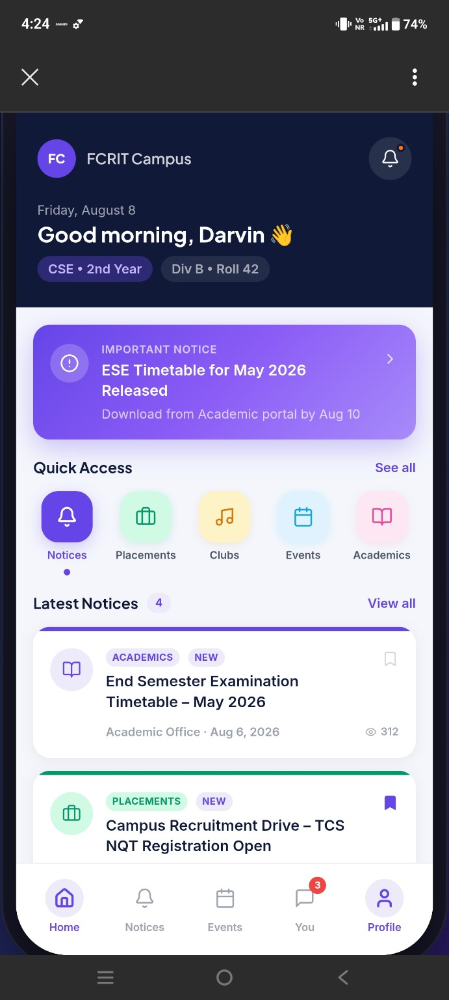
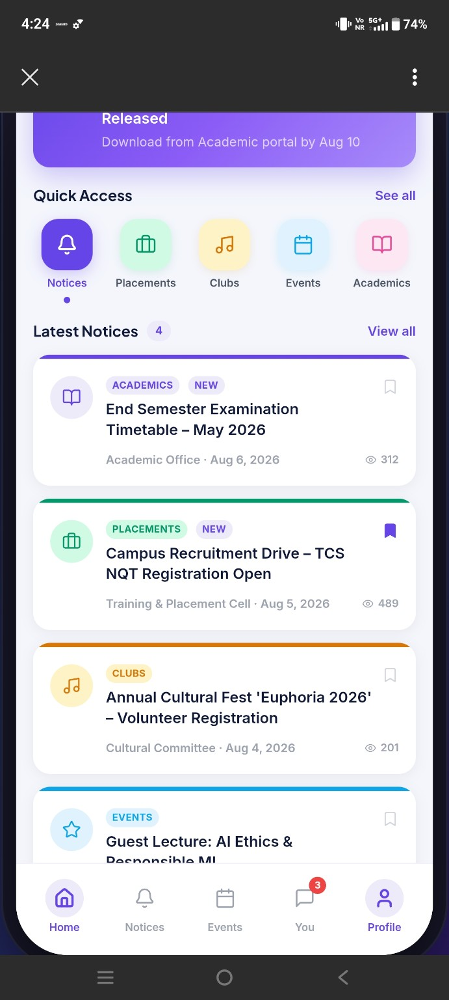
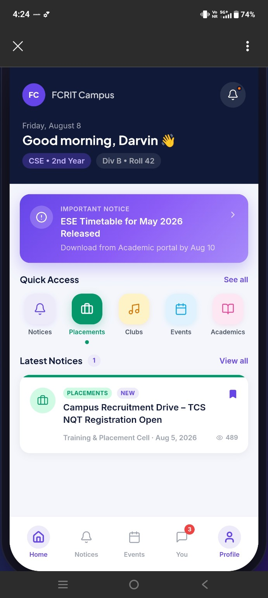
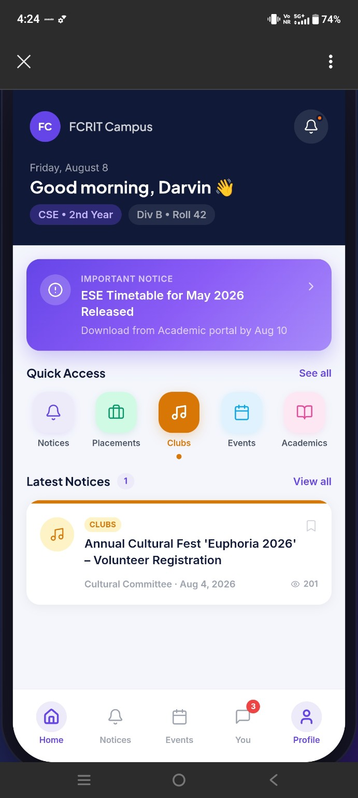
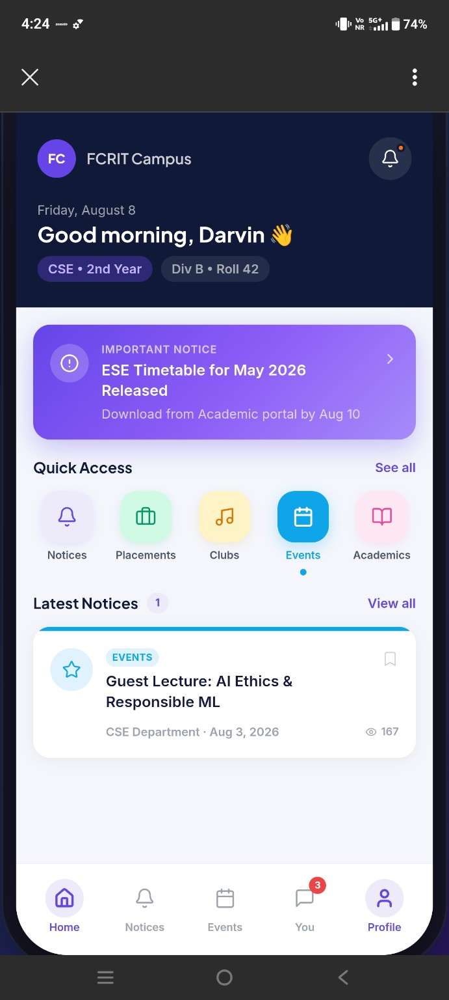
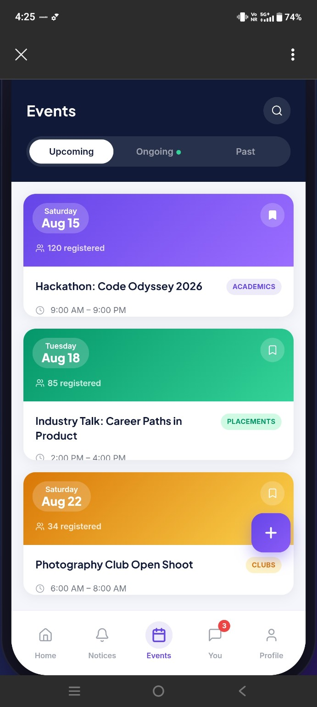
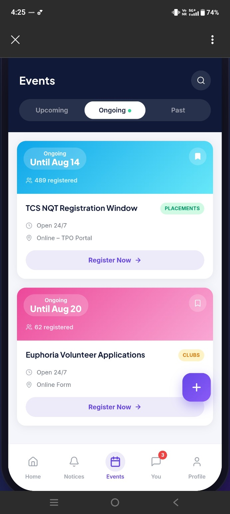
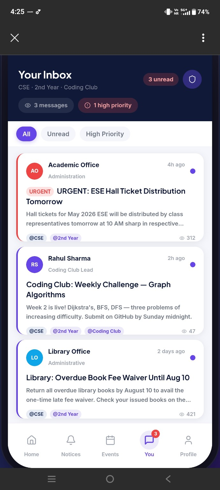

# FCRIT Campus — Flutter Desktop UI Implementation Brief

## Goal

Update the existing **FCRIT Campus** app and build a polished **desktop/PC experience using Flutter and Dart**. Use the attached screenshots as visual references for the current mobile app. Keep the same brand identity and features, but adapt the layout intelligently for larger screens instead of simply stretching the mobile UI.

## Important change: remove the bottom Notices tab

- **Remove the separate “Notices” item from the bottom navigation bar** because notices are already available on the Home page.
- Keep the Home page’s **Important Notice** banner, **Quick Access → Notices** shortcut, and **Latest Notices** section.
- The Home page must remain the main place to preview notices. Clicking “View all” or the Notices shortcut should open the existing notices list/filter view if that feature exists.
- Do not delete the notice functionality, notice data, notice details, filters, bookmarks, read status, or notice-related routes. Remove only the redundant bottom navigation item and update navigation/index logic safely.
- After removing Notices, make sure the remaining navigation destinations still work correctly and the selected/highlighted state is correct.

## Technology and implementation constraints

1. Use **Flutter + Dart**. Extend the existing project rather than creating an unrelated demo app.
2. First inspect the repository structure, current screens, routing/navigation, state management, models, API calls, and theme. Reuse existing implementations and data.
3. Avoid replacing real integrations with hard-coded mock data. If the current project uses sample data, preserve it and keep the UI architecture ready for real API data.
4. Use responsive layouts with `LayoutBuilder` or `MediaQuery` and reusable widgets. Do not create a separate, duplicated codebase for desktop.
5. The desktop layout should work well on common laptop/desktop widths (roughly 1024 px and above), while the mobile layout should continue to work.
6. Use clean, maintainable Dart code, sensible widget separation, and consistent naming. Do not rewrite unrelated features.
7. Run `dart format`, `flutter analyze`, and available tests. Fix issues caused by these changes.

## Design direction

Match the supplied screenshots:

- **Brand:** FCRIT Campus
- **Primary background:** deep navy
- **Accent:** vibrant purple/violet gradient
- **Content surfaces:** white or very light lavender-gray
- **Typography:** clear, modern sans-serif; strong page titles and readable secondary text
- **Components:** rounded cards, subtle shadows, pill-shaped labels and filters, consistent spacing, simple line icons
- **Category colors:** purple for academics/notices, green for placements, amber/orange for clubs, cyan/blue for events, pink for cultural items
- Keep contrast accessible. Do not rely on color alone to communicate category or selection.

Use the screenshots as a reference for visual style, not as exact pixel dimensions.

## Desktop navigation and overall shell

Create a desktop-specific responsive shell while reusing the same pages and functionality.

### Recommended desktop structure

- A **persistent left sidebar** containing the FCRIT Campus logo/name and primary navigation.
- Main content area with a comfortable maximum width and consistent padding.
- Optional right-side panel only where it genuinely improves the experience, such as upcoming events or priority messages. Do not overcrowd the screen.
- A top bar for page title, search where relevant, notification indicator, and profile/account access.
- Prefer a desktop sidebar or navigation rail over the mobile bottom navigation on wide screens.
- On mobile, preserve a compact bottom navigation, but **without the Notices item**.

### Navigation destinations

Keep the available destinations/features represented in the current app, such as:

- Home
- Events
- Inbox / You (messages)
- Profile
- Other existing sections such as Placements, Clubs, and Academics, accessible from Home Quick Access or the existing “See all” destinations.

Do not add a separate primary navigation destination called **Notices**. Notices remain discoverable from Home.

If the current project uses different route names, follow its existing route conventions and map these destinations to the existing pages.

## Home page

Build a desktop-friendly version of the Home page shown in the references.

### Header / welcome section

- FCRIT Campus branding.
- Greeting with the student’s name.
- Department, year, division, and roll-number chips where available.
- Notification icon with unread indicator.
- On desktop, use a compact horizontal header rather than an excessively tall mobile-style banner.

### Important Notice banner

- Prominent purple gradient banner near the top of Home.
- Show notice priority/label, title, short description, and chevron/action.
- Make the whole banner clickable if that matches existing behavior.
- Ensure long titles and descriptions wrap without overflow.

### Quick Access

- Keep shortcuts for Notices, Placements, Clubs, Events, and Academics.
- On desktop, display these in a horizontal row or responsive grid with comfortable spacing.
- The Notices shortcut opens the notices listing; it must not restore a bottom Notices tab.

### Latest Notices

- Display the latest notice cards directly on Home.
- On wide screens, use a responsive grid or a main feed with a secondary column, depending on the existing content.
- Each card should support the existing information: category, NEW badge where appropriate, title, publisher/department, date, view count, and bookmark state.
- Use a category accent strip/icon similar to the screenshots.
- Keep “View all” visible and functional.
- Make text readable by default. Avoid low-contrast text that only becomes visible on hover.
- Cards must not overlap or clip when the window is resized.

## Events page

Use the event screenshots as the design reference.

- Page title “Events” and a search action.
- Tabs/segmented control for **Upcoming**, **Ongoing**, and **Past**.
- Event cards with date, registration count, title, category label, time, location/venue where available, bookmark action, and registration CTA when applicable.
- Use category-colored headers or accents, with the rest of each card on a light surface.
- On desktop, use a two-column or three-column responsive card grid where space permits.
- Keep card heights and spacing visually consistent without truncating important information.
- Search, filters, bookmarks, and registration actions must continue to use existing functionality.

## Inbox / messages page

Use the “Your Inbox” screenshot as a reference.

- Show page title, unread count, high-priority count, and relevant audience/context chips.
- Include filters such as All, Unread, and High Priority.
- Message cards should show sender/avatar, sender role, time, priority, subject, short preview, audience tags, and read/unread indicator.
- High-priority messages should be visually obvious but not visually overwhelming.
- On desktop, consider a two-pane inbox: message list on the left and selected message detail on the right, if compatible with the current architecture.
- Preserve existing read/unread state and message actions.

## Profile setup and profile page

Use the profile setup screenshots as a reference.

- Department selection: CSE, Mechanical, Civil, EXTC (or the existing available departments).
- Year of study: 1st, 2nd, 3rd, 4th.
- Clubs & Groups multi-select: AI/ML, Coding, E-Cell, Sports, Cultural, plus any existing options.
- Clearly distinguish selected and unselected options.
- Keep required-field indicators and helper text.
- Keep “Get Started” prominent and functional.
- The profile information should remain editable later from Profile settings.
- On desktop, use a centered form or a two-column layout where appropriate; avoid an excessively narrow mobile-sized form.

## Responsive behavior

Implement and verify these behaviors:

- **Mobile:** compact header, existing mobile card flow, bottom navigation with the redundant Notices item removed.
- **Tablet:** use available width efficiently; avoid overly stretched cards.
- **Desktop:** persistent sidebar, top bar, wider content region, responsive card grids, and sensible whitespace.
- Support resizing without RenderFlex overflow, clipped text, hidden actions, or overlapping floating buttons.
- Ensure dialogs, menus, forms, and event details remain usable with mouse, keyboard, and touch.
- Use hover states on desktop, but all key text and actions must be visible without hovering.
- Respect system text scaling where possible.

## Navigation and interaction checks

After the UI changes, verify:

- The bottom navigation no longer contains Notices.
- Home still shows the Important Notice banner, Notices Quick Access shortcut, and Latest Notices.
- “View all” and the Quick Access Notices shortcut open the notice list correctly.
- Every remaining navigation item opens the correct page.
- Selected navigation states and unread badges are correct.
- Event tabs and search work.
- Bookmark controls toggle and retain their state as before.
- Profile setup selections and Get Started work.
- Inbox filters and read/unread indicators work.
- Back navigation works without returning to a removed bottom-navigation destination.
- Existing API calls, models, and state management continue to function.

## Reference screenshots

The following screenshots are included in the `reference_images/` folder. Inspect them before implementing the UI.

### 1. Profile setup — upper section

### 2. Profile setup — Get Started button and full form

### 3. Home page — header, Important Notice, Quick Access, and first notice cards

### 4. Home page — latest notices list

### 5. Home page — Placements Quick Access filter state

### 6. Home page — Clubs Quick Access filter state

### 7. Home page — Events Quick Access filter state

### 8. Events page — Upcoming events

### 9. Events page — Ongoing events

### 10. Inbox — All messages, unread and high-priority indicators

## Expected deliverables

1. Updated Flutter/Dart source code in the existing project.
2. Responsive desktop/PC layout consistent with the mobile app’s branding.
3. Redundant bottom Notices navigation item removed without deleting the notices feature.
4. Home notices banner, Quick Access, and Latest Notices fully preserved and functional.
5. Any necessary navigation, layout, and widget tests updated or added.
6. A short implementation summary listing files changed, desktop layout approach, and checks run.
7. A list of any issues that could not be completed and why.

## Final instruction

**Inspect first, then implement.** Do not only provide recommendations or a mockup. Make the changes directly in the existing project, preserve working functionality, and verify the result. Prioritize removing the duplicate bottom Notices destination and delivering a polished responsive desktop experience in Flutter/Dart.
